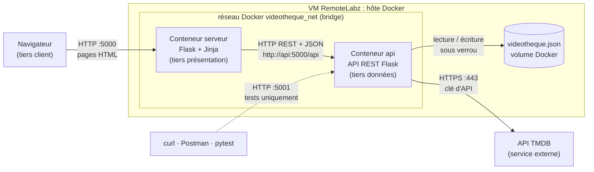
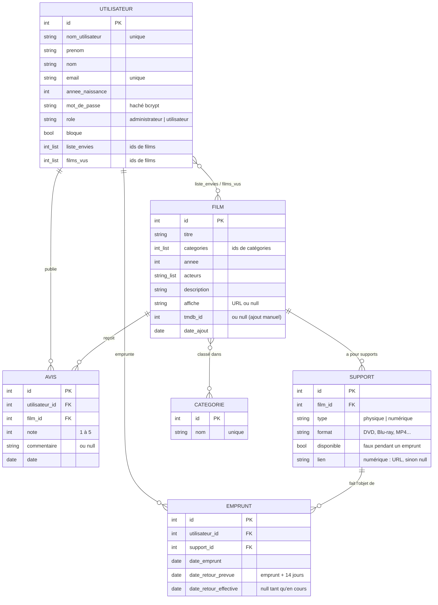
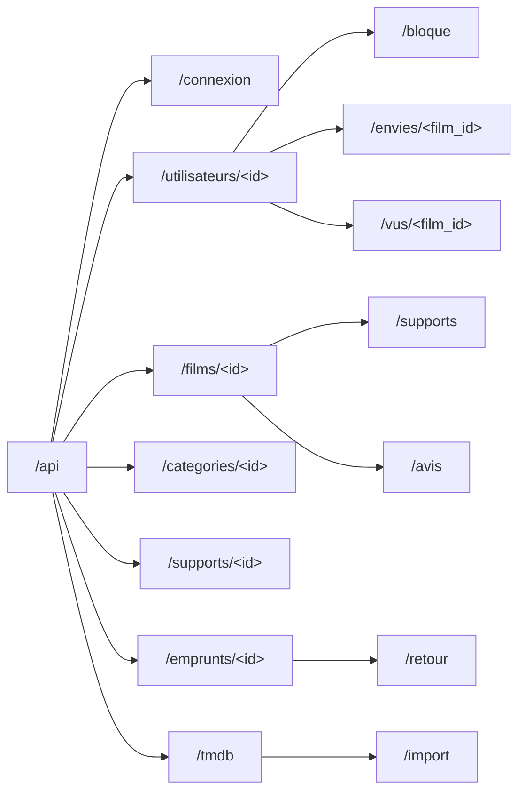
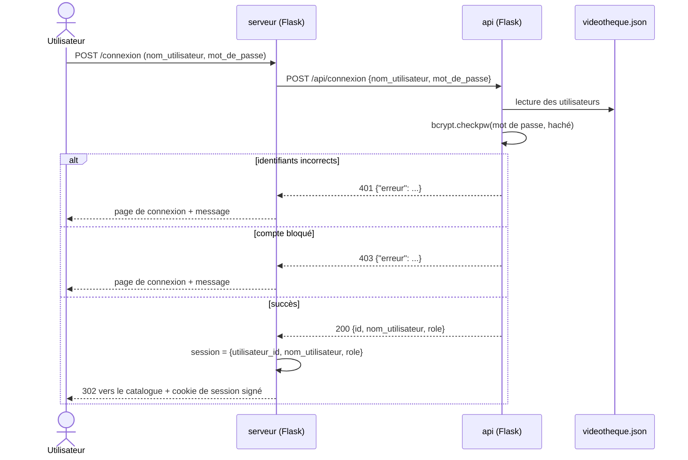
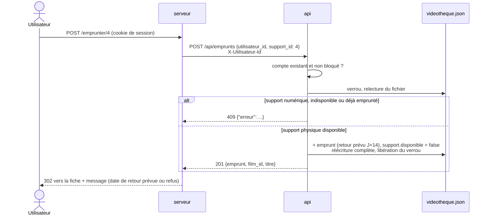
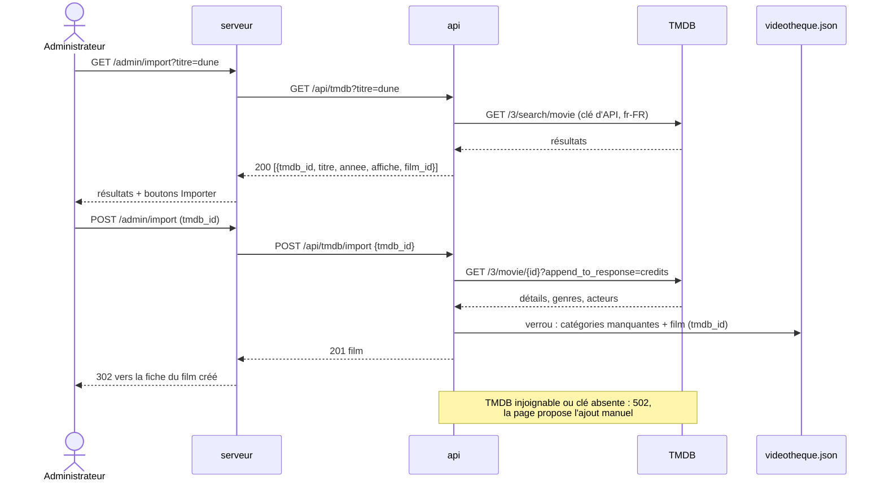

# videotek-api — tiers données de la vidéothèque

API REST Flask du TP **RT0705 « Gestion d'une vidéothèque »**. C'est le
**tiers d'accès aux données** d'une application web 3 tiers : elle seule lit et
écrit le fichier JSON de la vidéothèque, applique les règles métier et
interroge TMDB pour importer des films. Le tiers présentation (site web) est
dans le repo [videotek-serveur](https://github.com/L4Curtis/videotek-serveur).

- Python 3.12 + Flask, échanges en JSON, stockage dans un fichier JSON unique
- Mots de passe hachés avec **bcrypt**, écritures sous **verrou**
- Exécutée dans un conteneur Docker (image commune `videotek-flask:1.0`)

## Architecture



Le navigateur ne parle qu'au serveur web ; seul le conteneur `api` accède au
fichier JSON et à TMDB. Le port 5001 de l'API n'est publié sur la VM que pour
les tests.

## Modèle de données

Toutes les données sont dans un seul fichier JSON : une liste par type d'objet,
liées par leurs identifiants (clés en `_id`). Les dates sont des chaînes
`AAAA-MM-JJ`. Un nouvel objet reçoit le plus grand identifiant de sa liste + 1.



```text
videotheque.json
├── utilisateurs : [ Utilisateur, … ]   → liste_envies, films_vus
├── films        : [ Film, … ]          → categories
├── categories   : [ Catégorie, … ]
├── supports     : [ Support, … ]       → film_id
├── emprunts     : [ Emprunt, … ]       → utilisateur_id, support_id
└── avis         : [ Avis, … ]          → utilisateur_id, film_id
```

## Routes de l'API

Base : `http://api:5000/api` dans le réseau Docker, `http://<VM>:5001/api`
depuis la VM. L'API ne gère pas de session : le serveur web transmet
l'identifiant de l'utilisateur connecté dans l'en-tête `X-Utilisateur-Id` (et,
selon la route, dans le champ `utilisateur_id`) ; l'API vérifie que ce compte
existe (401) et n'est pas bloqué (403). Les routes *(admin)* ne sont appelées
que depuis les pages d'administration, dont le serveur web vérifie le rôle.



| Requête | Corps JSON | Opération et réponse |
|---|---|---|
| `GET /api` | — | Description de l'API et liste des routes (sert au test de santé) |
| `POST /api/utilisateurs` | nom_utilisateur, prenom, nom, email, annee_naissance, mot_de_passe | Inscription : vérifie les champs et l'unicité, hache le mot de passe ; **201** + utilisateur, 400, **409** doublon |
| `POST /api/connexion` | nom_utilisateur, mot_de_passe | **200** + id, nom_utilisateur, role ; **401** identifiants incorrects, **403** compte bloqué |
| `GET /api/utilisateurs` | — | *(admin)* Liste des comptes, sans les mots de passe |
| `GET /api/utilisateurs/<id>` | — | Compte avec sa liste d'envies et ses films vus ; 404 |
| `PUT /api/utilisateurs/<id>/bloque` | bloque (true/false) | *(admin)* Bloque ou débloque ; 200, 400, 404 |
| `POST`, `DELETE /api/utilisateurs/<id>/envies/<film_id>` | — | Ajoute / retire de la liste d'envies ; 200 + liste |
| `POST`, `DELETE /api/utilisateurs/<id>/vus/<film_id>` | — | Ajoute / retire des films vus ; 200 + liste |
| `GET /api/films?q=…&annee=…&categorie=…&tri=…` | — | Recherche (titre ou acteur, sans tenir compte des accents ni de la casse), filtres, tri `titre`, `note` ou `date_ajout` ; 200 + films avec `note_moyenne` et `nb_avis` |
| `GET /api/films/<id>` | — | Fiche : film, note moyenne, `supports` et `avis` (avec le nom de l'auteur) ; 404 |
| `POST /api/films` | titre, annee, categories, acteurs, description, affiche | *(admin)* Ajout manuel avec la date d'ajout ; 201 + film |
| `PUT /api/films/<id>` | champs à modifier | *(admin)* 200 + film, 400, 404 |
| `DELETE /api/films/<id>` | — | *(admin)* **409** si un support est emprunté ; sinon supprime le film, ses supports, ses avis, ses emprunts terminés et le retire des listes ; 200 |
| `GET /api/categories` | — | Liste triée par nom |
| `POST /api/categories` | nom | *(admin)* 201, **409** si le nom existe (casse et accents ignorés) |
| `PUT /api/categories/<id>` | nom | *(admin)* Renomme ; 200, 404, 409 |
| `DELETE /api/categories/<id>` | — | *(admin)* Supprime et retire des films ; 200, 404 |
| `POST /api/films/<id>/supports` | type, format, lien | *(admin)* Ajoute un support (`disponible: true`, lien obligatoire si numérique) ; 201 |
| `PUT /api/supports/<id>` | type, format, lien, disponible | *(admin)* 200 ; **409** si on change le type ou rend disponible un support emprunté |
| `DELETE /api/supports/<id>` | — | *(admin)* **409** si emprunté ; sinon 200 |
| `GET /api/emprunts?utilisateur_id=…` | — | Emprunts de l'utilisateur (tous sans paramètre, pour l'admin), en cours d'abord, avec `film_id`, `titre`, `format`, `nom_utilisateur` |
| `POST /api/emprunts` | utilisateur_id, support_id | Support physique et disponible : crée l'emprunt (retour prévu à **+14 jours**) et rend le support indisponible ; 201, **409** |
| `PUT /api/emprunts/<id>/retour` | utilisateur_id | L'emprunt doit appartenir à l'utilisateur (404) et être en cours (409) ; enregistre la date de retour, rend le support disponible ; 200 |
| `POST /api/films/<id>/avis` | utilisateur_id, note, commentaire | Note de 1 à 5 ; crée l'avis ou remplace celui de l'utilisateur ; 201 |
| `GET /api/tmdb?titre=…` | — | *(admin)* Recherche TMDB ; 200 + `tmdb_id`, `titre`, `annee`, `affiche`, `film_id` (si déjà importé) ; **502** TMDB injoignable |
| `POST /api/tmdb/import` | tmdb_id | *(admin)* Détails + acteurs depuis TMDB, crée les catégories manquantes puis le film ; 201, 404, **409** déjà importé, 502 |

**Codes de retour** : 200 succès · 201 créé · 400 données invalides · 401
identifiants incorrects · 403 compte bloqué (réservé à ce cas) · 404 objet
inexistant · 409 conflit · 502 TMDB injoignable. Toute erreur est renvoyée sous
la forme `{"erreur": "message"}`.

## Scénarios d'échange

### Connexion



### Emprunt d'un film physique



### Import d'un film depuis TMDB



## Stockage et concurrence

Le module [`stockage.py`](stockage.py) est le seul accès au fichier :

- `lire()` renvoie tout le fichier (lecture seule, sans verrou) ;
- `with transaction() as donnees:` relit le fichier **sous verrou**, laisse la
  route le modifier puis le **réécrit en entier** ; si la route lève une
  erreur (400, 404, 409…), rien n'est écrit ;
- verrou `threading.Lock` (requêtes simultanées du serveur Flask) + `fcntl.flock`
  sur `videotheque.json.lock` (processus différents : l'API et `creer_admin.py`) ;
- écriture atomique (fichier temporaire puis `os.replace`) : une lecture voit
  toujours un fichier complet ;
- au démarrage, si le fichier n'existe pas, il est créé avec les six listes vides.

Le chemin du fichier est lu dans `VIDEOTHEQUE_FICHIER`, ce qui permet de
passer du fichier de test au fichier réel sans modifier le code.

## Démarrage

Prérequis sur la VM : `docker`, `docker compose`, `git`.

**API seule** (développement et tests de l'API sur le port 5001) :

```bash
git clone https://github.com/L4Curtis/videotek-api.git
cd videotek-api
cp .env.example .env          # puis renseigner TMDB_CLE
docker compose up -d --build
curl http://localhost:5001/api
```

**Application complète** (API + site web) : depuis le repo
[videotek-serveur](https://github.com/L4Curtis/videotek-serveur), cloné à côté
de celui-ci, qui contient le `docker-compose.yml` global. Les deux fichiers
compose publient le port 5001 : n'en lancer qu'un à la fois.

| Variable (`.env`) | Rôle |
|---|---|
| `VIDEOTHEQUE_FICHIER` | Fichier JSON utilisé : `/app/donnees/videotheque_test.json` (préproduction) ou `/donnees/videotheque.json` (production, volume Docker `videotek_donnees`) |
| `TMDB_CLE` | Clé d'API TMDB v3 ou jeton d'accès en lecture v4 (<https://www.themoviedb.org/settings/api>) |

## Préproduction et production

- **Préproduction** : `VIDEOTHEQUE_FICHIER=/app/donnees/videotheque_test.json`.
  Le fichier de test contient 4 comptes, 12 films, 11 catégories, 19 supports,
  4 emprunts (dont un en retard) et 9 avis. Pour le remettre dans son état
  d'origine : `git checkout -- donnees/videotheque_test.json`.

  | Compte de test | Mot de passe | Rôle |
  |---|---|---|
  | `admin` | `admin-2026` | administrateur |
  | `alice` | `alice-2026` | utilisateur |
  | `bob` | `bob-2026` | utilisateur |
  | `chloe` | `chloe-2026` | utilisateur bloqué |

- **Production** : `VIDEOTHEQUE_FICHIER=/donnees/videotheque.json`. Le fichier
  est créé vide au premier démarrage, puis on crée le premier administrateur :

```bash
docker compose exec api python creer_admin.py <nom_utilisateur>
```

[`creer_admin.py`](creer_admin.py) demande deux fois le mot de passe (saisie
masquée) et le hache avec bcrypt. Si le compte n'existe pas, il le crée avec le
rôle administrateur (prénom, nom, e-mail, année de naissance demandés) ; s'il
existe, il remplace son mot de passe, le passe administrateur et le débloque
(mot de passe perdu, nouvel administrateur). C'est le seul moyen d'obtenir ce
rôle : aucune route de l'API ne le donne.

## Tests

```bash
# tests unitaires (copie temporaire du fichier de test, TMDB simulé)
docker compose exec api python -m pytest -v

# scénario curl sur l'API lancée (codes de retour de chaque route)
./tests/tests_curl.sh
API_URL=http://10.11.16.145:5001/api ./tests/tests_curl.sh
```

- [`tests/test_api.py`](tests/test_api.py) : 41 tests pytest (toutes les routes,
  codes d'erreur, règles métier, verrou d'écriture, import TMDB simulé).
- [`tests/tests_curl.sh`](tests/tests_curl.sh) : scénario de bout en bout en
  curl (inscription → catalogue → supports → emprunt → retour → avis → blocage
  → TMDB → nettoyage), avec le code attendu de chaque appel.

## Structure du repo

```text
videotek-api/
├── app.py               routes de l'API REST, validation, règles métier
├── stockage.py          lecture / écriture du fichier JSON sous verrou
├── comptes.py           règles des comptes, hachage bcrypt (API + script)
├── tmdb.py              client de l'API TMDB (recherche, détails + acteurs)
├── creer_admin.py       création / réinitialisation d'un administrateur
├── donnees/
│   └── videotheque_test.json   fichier de préproduction
├── tests/
│   ├── conftest.py      fixtures pytest
│   ├── test_api.py      tests unitaires
│   └── tests_curl.sh    scénario curl
├── Dockerfile           image commune videotek-flask:1.0 (identique dans les 2 repos)
├── docker-compose.yml   API seule (port 5001)
├── .env.example         variables d'environnement
├── requirements.txt
└── AGENTS.md            consignes pour faire évoluer le projet
```
